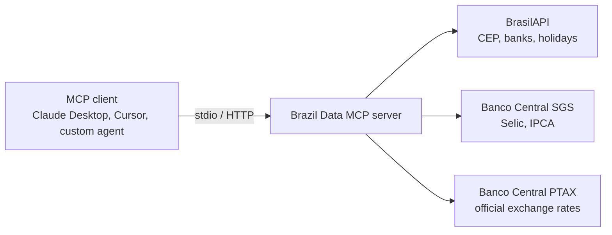

# Brazil Data MCP

An [MCP (Model Context Protocol)](https://modelcontextprotocol.io) server that gives LLM agents access to Brazilian public data: Central Bank series (Selic, IPCA), exchange rates, postal codes (CEP), banks and national holidays.

> **Status:** work in progress. See the [roadmap](#roadmap).

## Why

Agents that work with Brazilian users constantly need the same public data: "what is the Selic rate today?", "how much is the dollar?", "what address is this CEP?". Each team ends up writing its own wrappers. This project packages those sources as MCP tools, so any MCP client (Claude Desktop, Claude Code, Cursor, custom agents) can use them with no extra code.

## Architecture



## Tools

| Tool | Description | Source |
|---|---|---|
| `get_address_by_cep` | Address for a Brazilian postal code | BrasilAPI |
| `list_national_holidays` | National holidays for a given year | BrasilAPI |
| `get_bank` | Bank name and details by bank code | BrasilAPI |
| `get_selic_rate` | Latest values of the Selic target rate | BCB SGS (series 432) |
| `get_ipca` | Latest monthly IPCA inflation values | BCB SGS (series 433) |
| `get_ptax_rate` | Official PTAX USD/BRL rate for a date | BCB PTAX |

## Getting started

Requires Python 3.11+ and [uv](https://docs.astral.sh/uv/).

```bash
git clone https://github.com/Mirelasbianchi/brazil-data-mcp.git
cd brazil-data-mcp
uv sync
uv run brazil-data-mcp          # starts the server over stdio
uv run mcp dev src/brazil_data_mcp/server.py   # opens the MCP Inspector
```

### Use with Claude Desktop

Add to `claude_desktop_config.json`:

```json
{
  "mcpServers": {
    "brazil-data": {
      "command": "uv",
      "args": ["--directory", "/path/to/brazil-data-mcp", "run", "brazil-data-mcp"]
    }
  }
}
```

## Project structure

```
brazil-data-mcp/
├── src/brazil_data_mcp/
│   ├── server.py      # MCP server and tool definitions
│   └── clients.py     # HTTP clients for BrasilAPI and Banco Central
├── tests/             # unit tests with mocked HTTP
├── .github/workflows/ # CI (lint + tests)
└── pyproject.toml
```

## Roadmap

- [x] Project skeleton, first tools and CI
- [ ] Error handling and input validation (invalid CEP, future dates, API downtime)
- [ ] Response caching for slow-changing data (holidays, banks)
- [ ] More sources: CNPJ lookup, B3 quotes, IBGE data
- [ ] Streamable HTTP transport for remote use
- [ ] Publish to PyPI and to the MCP server registry
- [ ] Demo video with an agent answering questions using the tools

## Development

```bash
uv run pytest
uv run ruff check .
```

## License

MIT
