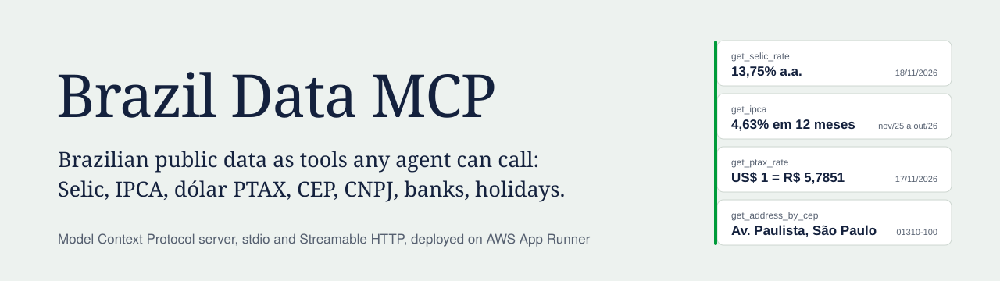
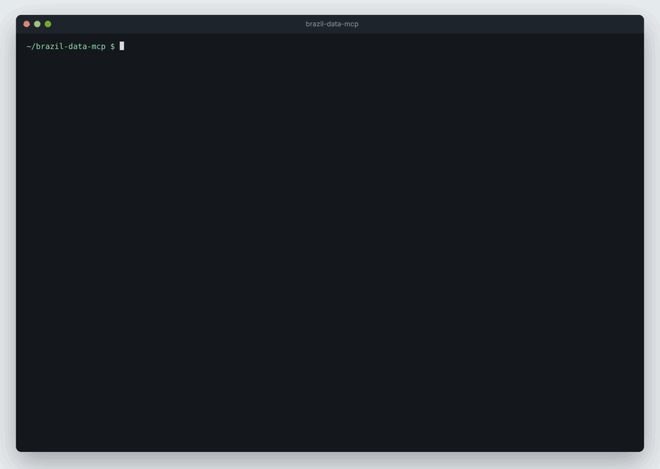
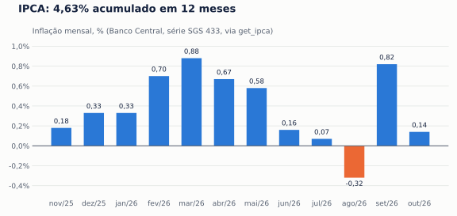
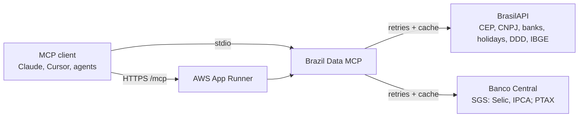

<p align="center"></p>

<p align="center">
  <a href="https://github.com/Mirelasbianchi/brazil-data-mcp/actions/workflows/ci.yml"></a>
  <a href="https://github.com/Mirelasbianchi/brazil-data-mcp/actions/workflows/deploy.yml"></a>
  
  
  
</p>

An [MCP (Model Context Protocol)](https://modelcontextprotocol.io) server that gives LLM agents Brazilian public data: the Selic rate, IPCA inflation, the official PTAX dollar rate, addresses by CEP, companies by CNPJ, banks, holidays, area codes and municipalities. Runs locally over stdio or hosted over Streamable HTTP on AWS.



<sub>`examples/demo.py --replay`, which serves responses recorded from the live APIs on 2026-11-18. [Full-resolution video (MP4)](docs/assets/demo.mp4).</sub>

## Why

Agents that work with Brazilian users keep needing the same public data: "quanto está a Selic?", "quanto o dólar fechou ontem?", "que endereço é esse CEP?". Each team writes its own wrappers, usually without retries, caching or input validation. This server packages those sources once, so any MCP client (Claude, Cursor, VS Code, custom agents) can use them with no extra code.

## Tools

| Tool | Returns | Source |
|---|---|---|
| `get_selic_rate` | Selic target rate as of today, with recent history | Banco Central SGS 432 |
| `get_ipca` | Monthly IPCA and the accumulated rate for the period | Banco Central SGS 433 |
| `get_ptax_rate` | Official USD/BRL buy and sell rates; falls back to the last business day | Banco Central PTAX |
| `get_address_by_cep` | Street, neighborhood, city, state and coordinates | BrasilAPI |
| `get_company_by_cnpj` | Legal and trade name, status, CNAE, address (CNPJ check digits validated first) | BrasilAPI / Receita Federal |
| `get_bank` | Bank name and details by COMPE code | BrasilAPI |
| `list_national_holidays` | National holidays of a year with weekdays | BrasilAPI |
| `get_ddd` | State and cities served by a phone area code | BrasilAPI |
| `list_municipalities` | Municipalities of a state with IBGE codes | BrasilAPI |

Every tool is annotated read-only and idempotent, returns structured output with a schema, and turns failures into messages the model can pass on ("CEP must have 8 digits", "Banco Central SGS is unavailable right now").

<p align="center"></p>

<sub>Chart made by `examples/plot_ipca.py`, which gets the data through the `get_ipca` tool.</sub>

## Built for unreliable public APIs

- **Retries** with exponential backoff on timeouts, HTTP 429 and 5xx. BrasilAPI rate-limits bursts, and that is exactly what an agent calling tools in a loop produces.
- **TTL cache** in memory: 24 h for BrasilAPI lookups, 1 h for Banco Central series.
- **Local validation** before any request: CEP length, CNPJ check digits, state codes, area codes, dates.
- **Correct "latest" Selic.** The SGS 432 series is published ahead of time, up to the next Copom meeting: on 2026-11-18 the "last 5 values" endpoint returned dates from 05/12 to 09/12/2026. The server queries a date range and never reports a value dated after today.
- **PTAX on non-business days** returns the last available quote and says which day it is from, instead of an empty answer.

## Getting started

Requires Python 3.11+ and [uv](https://docs.astral.sh/uv/).

```bash
git clone https://github.com/Mirelasbianchi/brazil-data-mcp.git
cd brazil-data-mcp
uv sync
uv run brazil-data-mcp                                   # stdio
uv run brazil-data-mcp --transport http --port 8000      # Streamable HTTP on /mcp, health on /health
uv run --group demo python examples/demo.py              # walk through the tools against the live APIs
uv run --group demo python examples/demo.py --replay     # same, offline, with recorded responses
```

### Claude Desktop (local, stdio)

```json
{
  "mcpServers": {
    "brazil-data": {
      "command": "uv",
      "args": ["--directory", "/path/to/brazil-data-mcp", "run", "brazil-data-mcp"]
    }
  }
}
```

### Any client (hosted, Streamable HTTP)

```json
{ "mcpServers": { "brazil-data": { "url": "https://<your-app-runner-id>.awsapprunner.com/mcp" } } }
```

## Deployment

The HTTP transport runs stateless with JSON responses, so it sits behind any load balancer. The repository deploys it to **AWS App Runner** (HTTPS, health checks, autoscaling) from an ECR image, provisioned with [Terraform](infra/terraform) and pushed by GitHub Actions through OIDC. Steps and costs in [`infra/README.md`](infra/README.md).



## Development

```bash
uv sync --all-groups
uv run pytest            # HTTP mocked with responses recorded from the live APIs
uv run ruff check .
```

CI runs the tests and the replay demo, builds the Docker image and smoke-tests `tools/list` over HTTP, and validates the Terraform.

## Project structure

```
brazil-data-mcp/
├── src/brazil_data_mcp/
│   ├── server.py      # MCP server and tool definitions
│   ├── clients.py     # BrasilAPI and Banco Central clients: retries, errors
│   ├── cache.py       # async TTL cache
│   ├── validation.py  # CEP, CNPJ, UF and DDD validation
│   └── http.py        # Streamable HTTP app and /health
├── examples/          # demo client, IPCA chart, replay of recorded responses
├── tests/             # unit tests + fixtures recorded on 2026-11-18
├── infra/terraform/   # AWS: ECR, App Runner, GitHub OIDC
└── .github/workflows/ # CI and deploy
```

## Roadmap

- [x] First tools and CI
- [x] Error handling, retries and input validation
- [x] Response caching
- [x] CNPJ, DDD and IBGE municipality tools
- [x] Streamable HTTP transport, Docker image and AWS deployment
- [x] Demo video and recorded-response replay
- [ ] More sources: B3 quotes, FIPE vehicle prices, IBGE indicators
- [ ] Authentication for the hosted endpoint
- [ ] Publish to PyPI and to the MCP server registry

## License

MIT
