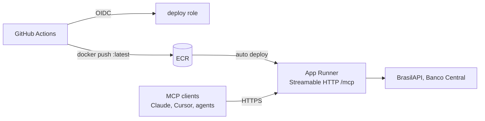

# Infrastructure (AWS)

The server runs on **AWS App Runner** from a private ECR image. App Runner provides the HTTPS
endpoint, health checks on `/health`, autoscaling (1–2 instances) and redeploys automatically
whenever GitHub Actions pushes a new `:latest` image.



## First deploy

The service needs an image to exist before it can be created, so the first deploy has three steps:

```bash
cd infra/terraform
terraform init
terraform apply -var create_service=false     # ECR, IAM and the GitHub OIDC role
```

In GitHub, **Settings → Secrets and variables → Actions → Variables**: set `AWS_ROLE_ARN`
(`terraform output -raw github_deploy_role_arn`) and `AWS_REGION`. Run the **Deploy to AWS**
workflow once to push the first image, then:

```bash
terraform apply                                # creates the App Runner service
terraform output mcp_url                       # https://<id>.<region>.awsapprunner.com/mcp
```

From then on every green CI run on `main` pushes a new image and App Runner rolls it out.

## Connect a client

```json
{ "mcpServers": { "brazil-data": { "url": "https://<id>.<region>.awsapprunner.com/mcp" } } }
```

The endpoint is public and has no authentication; it only exposes read-only public data.
Put it behind an API key or OAuth before exposing anything private.

## Cost

One 0.25 vCPU / 0.5 GB instance kept warm costs roughly **US$ 5–15 per month** depending on
traffic (check the App Runner pricing page). `terraform destroy` removes everything.
